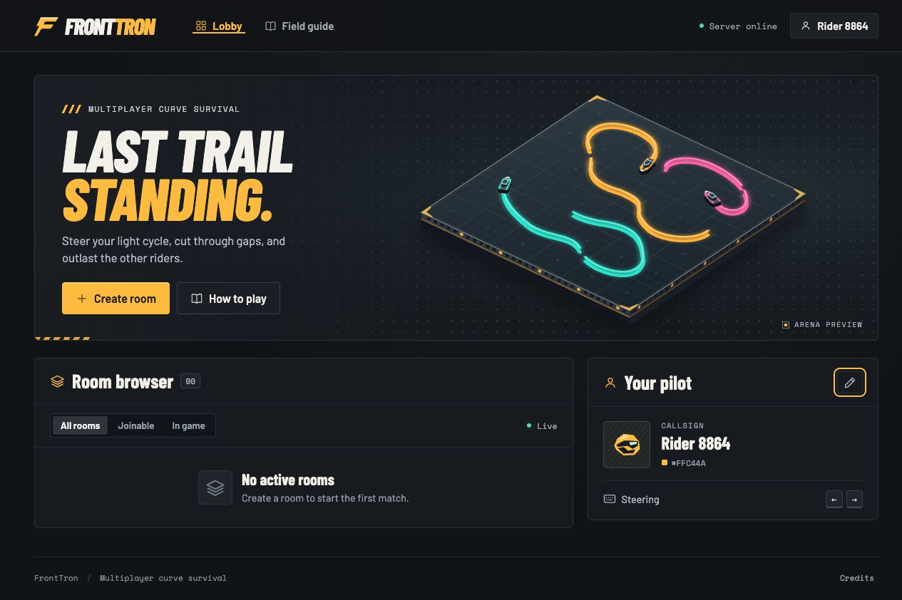

# FrontTron

FrontTron is a real-time multiplayer curve-survival game for the browser. It runs the Langtron rules on a Node.js server and renders a raised isometric arena with Canvas 2D. The browser sends steering inputs. The server decides positions, collisions, pickups, scores, round outcomes, and room permissions.



## Run locally

Use Node.js 22 or newer. From the repository root, run

```sh
cd fronttron
npm ci
npm start
```

Open **http://localhost:8080**. The server listens on all interfaces by default. Other players on the same network can open the server's LAN address on port 8080. All browser assets, including fonts, are bundled here.

Select **Create room**. An empty room name generates one automatically. Edit the callsign, trail color, and steering from **Your pilot** or by selecting a rider's keys in the room. Add another local rider to share a keyboard, or use **Invite** to copy the room link. **Ready** starts the match as soon as everyone is ready, including in solo play. The host's **Start now** begins a cancellable five-second countdown.

Hold Left or Right to steer and release to travel straight. Turn through gaps in the trails and collect pickups. The field guide explains the rules. Select **Use touch controls** for touch steering. For a gamepad, activate the controller, select a steering binding, then press a button or move an axis.

## Computer riders

The host can select **Add bot** in a ready room and choose **Easy** (reactive), **Normal** (predictive steering), **Hard** (territory and opponent search), **Mimic** (imitation learning), or **Apex** (reinforcement learning). Add up to three bots, then press **Ready** to race. **Edit bot** changes or removes a computer rider before the next match. All five run on the game server. The Node and Docker distributions include both learned policies. [Training and head-to-head results](docs/ai-players.md#apex-head-to-head-results)

## Host with Docker

Build from this directory, with the Dockerfile and package-lock.json alongside it.

```sh
docker build -t fronttron .
docker run -d --name fronttron --restart unless-stopped -p 8080:8080 fronttron
```

A single container serves both the web page and the WebSocket at `/ws`. Use a single game-server process per public lobby. Rooms and active matches live in that process's memory and end when it restarts. Players' profiles persist in their browsers.

For a public domain, point DNS at the server, enable HTTPS on your reverse proxy, and proxy the whole origin including WebSocket upgrades. With Caddy running on the host, a site block for a container published to host port 8080 can be as small as

```caddyfile
game.example.com {
    reverse_proxy 127.0.0.1:8080
}
```

Use your domain in place of the example. In a container platform, set the build context to `fronttron`, the internal port to `8080`, and the HTTP health probe to `/healthz`.

## Configuration

| Environment variable | Purpose |
| --- | --- |
| PORT | HTTP and WebSocket port. Default 8080. |
| HOST | Bind address. Default 0.0.0.0. |
| ANALYTICS_ID | Optional Google Analytics measurement ID for page views. |

## Verification and source

```sh
npm test
```

Tests start ephemeral local servers and exercise independent WebSocket clients. The rules suite also uses controlled game time to collect and expire each selectable pickup.

- `server/start.js`, `server/server.js`, `server/session.js` — startup, HTTP hosting, and WebSocket transport.
- `server/engine/` — modular port of the original shared and server game rules, room controllers, and bonus implementations.
- `public/app.js`, `views.js`, `controls.js` — browser navigation, lobby, profile, room controls, chat, and input handling.
- `public/match.js` — render state shared by live clients and the server's mid-game spectator snapshot.
- `public/arena.js` — world-to-screen projection, arena, bikes, trails, pickups and effects.
- [Phased implementation plan](IMPLEMENTATION_PLAN.md)
- [Original project license](LICENSE) and [audio credits](public/sounds/CREDITS.txt). Typefaces include their licenses in `public/fonts/`.
